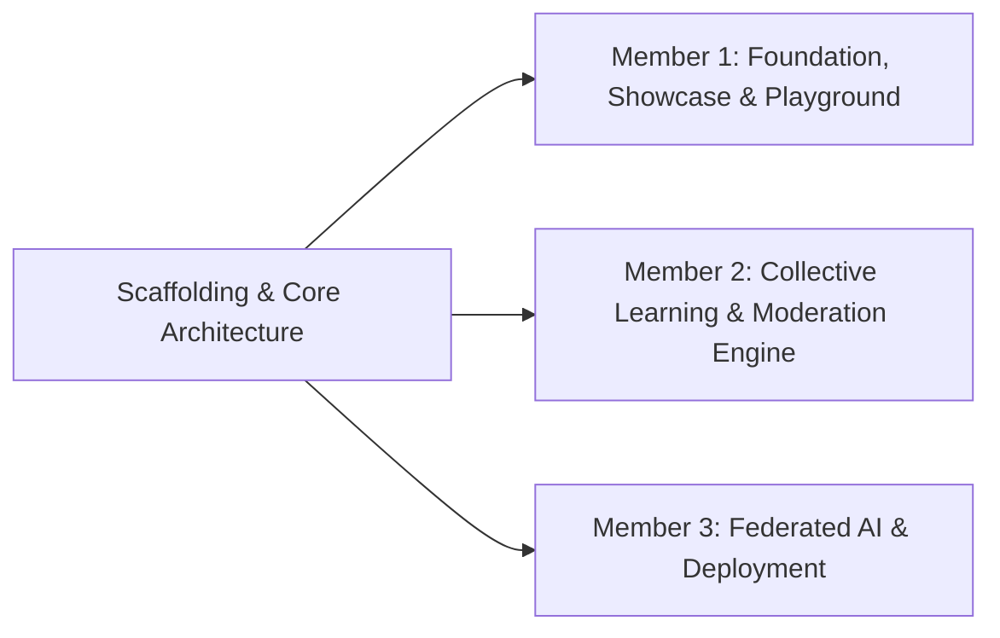

# azentio.ai - Enterprise AI & Intelligent Collaboration Portal
> **Azentio.ai Build Labs 2026 Special Challenge Solution**  
> *Build intelligence. Create shared value.*

---

## 🌟 Overview & Purpose

**azentio.ai** is Azentio Software’s flagship enterprise AI showcase and secure collaboration portal. It bridges public banking discovery with private institutional client collaboration and employee innovation.

The defining breakthrough of this platform is the **Governed Collective Learning Hub**: a privacy-preserving mechanism that captures market observations and edge cases across financial institutions, sanitizes PII and proprietary numbers, aggregates them into cross-client themes once $k \ge 3$ distinct banks report, and directly feeds product enhancements back to clients—without ever exposing confidential client data.

---

## 🛡️ Architecture & Persona Boundaries (IAM-01 & IAM-02)

| Persona | Permitted Scope | Strict Boundaries |
| :--- | :--- | :--- |
| **🌐 Public Visitor** | Public solutions catalog, approved product videos, public insights, demo request, hackathon sign-up. | No private workspaces, client observations, internal broadcasts, or raw APIs. |
| **💼 Employee (`@azentio.com`)** | Internal AI Playground with synthetic data, internal broadcasts, hackathon spaces, experiment drafts. | Least privilege: cannot inspect client-private drafts without explicit authorization. |
| **🏦 Client Member (Apex, Horizon, Vanguard)** | Organization-specific workspace, entitled sandboxes, "Our Observations", approved shared community feed. | Multi-tenant isolation: strict boundaries between banks; no employee-only experiments. |
| **🛡️ Learning Moderator** | Review proposed shared observations, redact sensitive figures/names, approve de-identified copies. | Cannot view unsubmitted client-private drafts; all moderation decisions audited. |
| **🎯 Product Owner** | Synthesize approved observations into Themes, create improvement ideas linked to evidence, update status. | No access to raw client identities or confidential underlying records. |
| **⚙️ Portal Administrator** | Audit logs, tenant management, and system governance. | Privileged actions audited; cannot bypass moderation auditing. |

---

## 🚀 Key Modules Built

1. **Public Enterprise AI Showcase:**
   - Dedicated showcase cards with live performance metrics for Azentio’s 4 core AI suites: *Financial Analysis Intelligence*, *Intelligent Credit Underwriting*, *Sentinel AML AI*, and *AIRA Banker Copilot*.
   - Interactive Demo Request & Hackathon Registration.

2. **Interactive SME Seasonality Sandbox (Section 10 Benchmark):**
   - Live interactive simulator comparing a legacy linear credit scoring model against the **Seasonality-Aware Azentio AI model**.
   - Demonstrates how collective learning prevents false-positive covenant alerts during peak seasonal inventory drawdowns.

3. **Governed Collective Learning Hub (P0):**
   - **Community Themes:** Requires $k \ge 3$ distinct client organizations (*Apex Commercial Bank*, *Horizon Islamic Banking*, *Vanguard Trust*) to aggregate.
   - **Searchable Approved Feed:** Sanitized, de-identified market observations.
   - **Moderator Redaction Queue:** Automated PII and account scanner with one-click sanitization and de-identified publication.
   - **Sub-60s Withdrawal Invalidation:** Immediate synchronous purge of withdrawn observations from community feeds, themes, and retrieval caches.
   - **Product Owner Improvement Loop:** Maps cross-client themes to product backlog items (`Under Review`, `Planned`, `Released`) with closed-loop client notifications.

4. **Multi-Tenant Client Workspaces:**
   - Instant switching between *Apex Commercial Bank*, *Horizon Islamic*, and *Vanguard Trust*.
   - Observation capture with real-time regex/NLP privacy scanning alerting to account codes, ticket numbers, or currency amounts.
   - Explicit sharing consent: Private to Author $\to$ Within Organization $\to$ Propose to Community.

5. **Employee Innovation Lab:**
   - Guided AI Playground running deterministic and machine-assisted simulations on synthetic cohorts.
   - Employee Live Broadcasts and Hackathon collaboration spaces.

6. **Federated Learning Simulator (P2 Track):**
   - Genuine decentralized training simulation across 3 isolated client nodes.
   - Central coordinator executing **FedAvg** with Differential Privacy accounting ($\epsilon = 1.48, \delta = 10^{-5}$) and global holdout accuracy tracking.

7. **Security & Governance Audit Trail:**
   - Real-time immutable event log tracking all server-side RBAC transitions, moderation approvals, and withdrawals.

8. **Judges Role Switcher Dock:**
   - Floating dock at the bottom allowing instant 1-click evaluation of every single persona, plus a **"Reset Demo"** button to restore the clean benchmark scenario at any time.

---

## 👥 Team Work Breakdown (Brownie Points Compliance)

To claim the **10 Additional Brownie Points**, this repository is designed for clean collaborative Git workflows:



### Member Contributions:
- **Member 1 (You):** Scaffolding, TypeScript types, global state management, Public AI Showcase, SME Seasonality Sandbox, and the Judges Role Switcher.
- **Member 2:** Multi-tenant observation form, real-time privacy scanner, Moderator Redaction UI, and PO theme aggregation ($k \ge 3$).
- **Member 3:** Federated learning simulation, Differential Privacy accounting, documentation, and cloud deployment on Vercel.

---

## 💻 Getting Started Locally

### Prerequisites
- Node.js 18+ (tested on Node v24)
- npm 10+

### Installation & Run
```bash
# Clone the repository
git clone https://github.com/YOUR_TEAM/azentio-lab.git
cd azentio-lab

# Install dependencies
npm install

# Start development server
npm run dev
```

Open [http://localhost:3000](http://localhost:3000) in your browser.

---

## 🌐 Deployment to Vercel

This repository is pre-configured for zero-config deployment to Vercel:
1. Push this repository to GitHub.
2. Import the repository into [Vercel](https://vercel.com).
3. Click **Deploy**.
